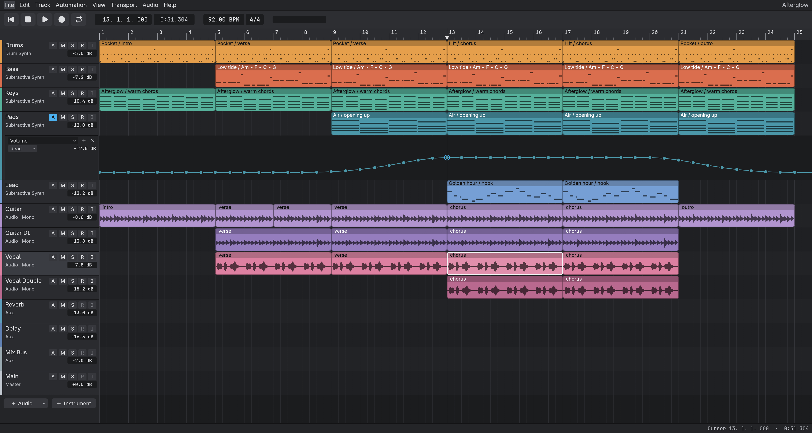
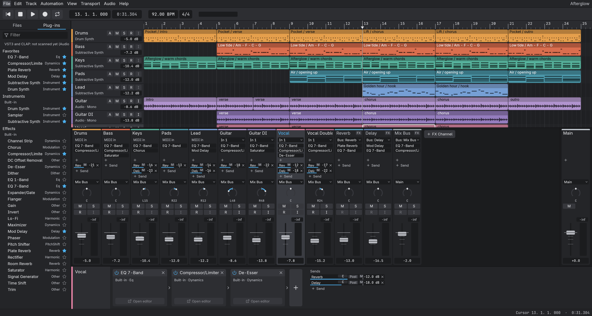
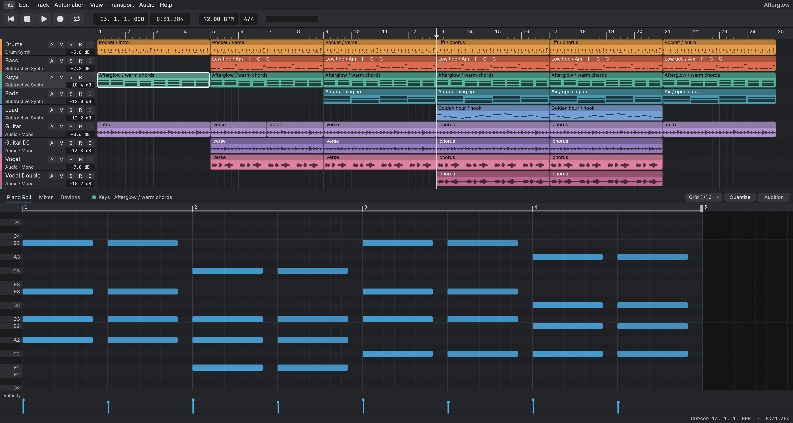

# transit

A desktop DAW built on the [SoundCraft](https://github.com/storytold/soundcraft) engine, with
Ableton/Logic-style ergonomics. Pure Rust, egui UI.



- Arrangement view with clips, tempo and a transport.
- Mixer with per-track device chains and drag-to-reorder.
- Piano roll with a velocity lane.
- Live MIDI from USB controllers into hosted instruments.
- CLAP and VST3 plug-in hosting.
- ASIO and WASAPI audio on Windows.




## Status

Pre-alpha. Windows is the tested platform; macOS and Linux build but are untested. Expect rough
edges and breaking changes to the session format. Back up anything you care about.

## Build

You need a Rust toolchain at 1.90 or newer (`rust-version` in `Cargo.toml`). On Linux, install
`libasound2-dev` and `pkg-config` first.

```sh
cargo build -p transit --release
```

The binary is `target/release/transit` (`transit.exe` on Windows).

### ASIO on Windows (optional)

ASIO is behind the `transit/asio` feature: `cargo build -p transit --release --features transit/asio`.
It needs LLVM (for bindgen; set `LIBCLANG_PATH` to LLVM's `bin`, and put LLVM before MinGW on
`PATH`), the Visual Studio 2019+ Build Tools, and the Steinberg ASIO SDK (`asio-sys` downloads it on
the first build unless `CPAL_ASIO_DIR` points at a copy). Steinberg's licensing terms apply to
anyone who redistributes ASIO-enabled binaries, so the published releases are WASAPI-only.

Full steps, the MinGW/libclang pitfall, and licensing: [docs/building.md](docs/building.md#building-with-asio-windows); scripted build: `tools/build-asio.ps1`.

## Run

```sh
cargo run -p transit --release            # empty session
cargo run -p transit --release -- --demo  # built-in demo song
transit --version
```

Settings, autosaves and logs live in a per-user folder: `%APPDATA%\transitDAW` on Windows,
`~/Library/Application Support/transitDAW` on macOS, `$XDG_CONFIG_HOME/transitdaw` (or
`~/.config/transitdaw`) elsewhere. Set `TRANSIT_CONFIG_DIR` to use another folder. An empty value
disables saving settings.

## Status and known issues

- Pre-alpha; the session format and UI change freely.
- Loading a plug-in can block the UI while it initializes.
- Only hardware outputs 1-2 open today; multi-output routing is planned.
- No sidechain inputs yet.
- Windows releases are unsigned: SmartScreen shows "More info", then "Run anyway".

## Based on SoundCraft

transit is based on [SoundCraft](https://github.com/storytold/soundcraft) by storytold, an
open-source Rust digital audio workstation. The audio engine, plug-in hosts and most crates come
from it; the transit UI and product work are by @derekmwright. The internal crates keep their
`soundcraft-*` names. Engine fixes may be offered back upstream.

## License

MIT OR Apache-2.0, at your option: see [LICENSE-MIT](LICENSE-MIT), [LICENSE-APACHE](LICENSE-APACHE)
and [NOTICE](NOTICE).

## Contributing

Issues are welcome; see [CONTRIBUTING.md](CONTRIBUTING.md).
